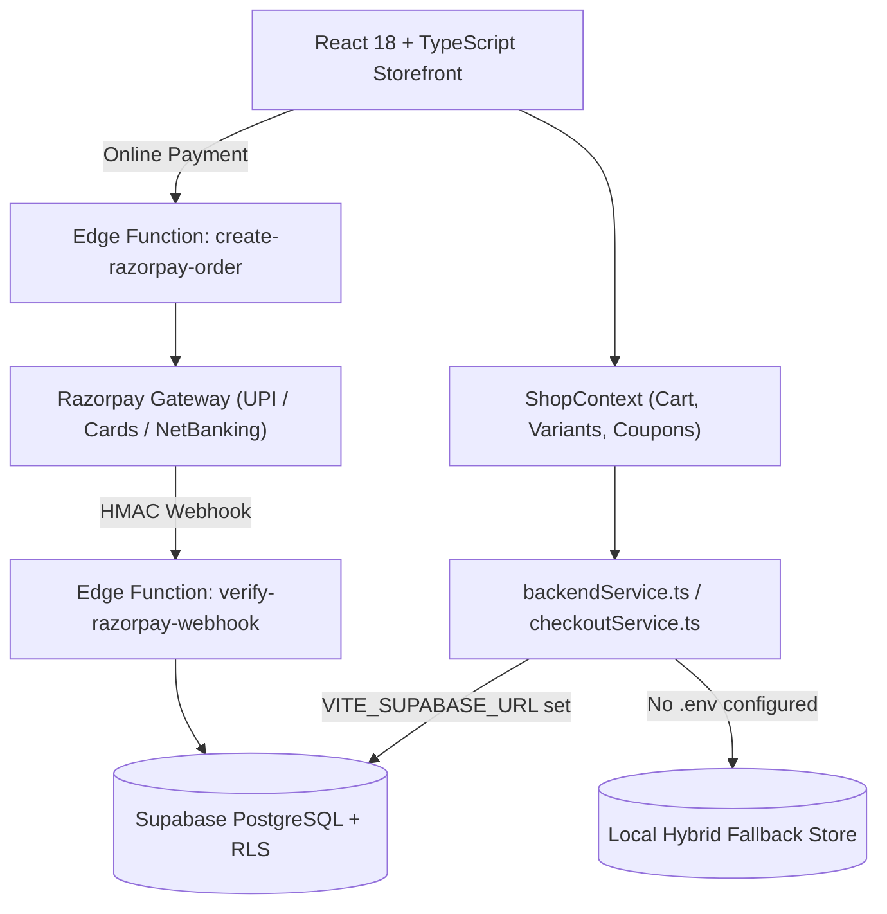
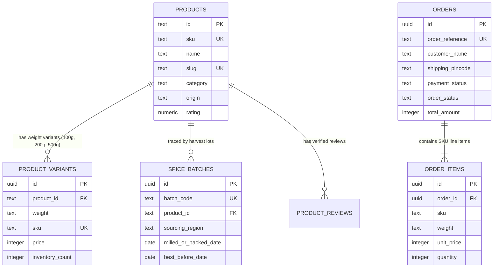

# AARANYA SPICES — Architecture & Design System

## 1. High-Level Architecture

Aaranya Spices is built as a modular, component-driven React + TypeScript application backed by **Supabase (PostgreSQL, Row Level Security, Auth, and Deno Edge Functions)**.

---

## 2. Database Entity-Relationship Model

Defined in [`supabase/migrations/20260929000001_initial_schema.sql`](../supabase/migrations/20260929000001_initial_schema.sql):

---

## 3. Visual & Typographic Design Tokens

Defined in [`src/index.css`](../src/index.css):

| Token | Value | Purpose |
| :--- | :--- | :--- |
| `--bg-ivory` | `#F7F4ED` | Primary warm parchment canvas |
| `--bg-sand` | `#EFECE3` | Elevated cards, specification tables, filter drawers |
| `--bg-forest` | `#182B21` | Primary brand dark forest green (Header bar, Footer, Primary CTAs) |
| `--bg-forest-deep` | `#0F1D16` | Hover state and deep hero overlays |
| `--text-charcoal` | `#1C1B18` | Primary editorial and body text |
| `--text-umbral` | `#5A564E` | Secondary body copy and captions |
| `--accent-ochre` | `#C89236` | Muted turmeric ochre accent |
| `--accent-earth` | `#6D4C38` | Earthy roasted-cumin brown eyebrows and tags |
| `--border-warm` | `#E2DDD2` | 1px structural dividers |

### Typography Hierarchy
1. **Editorial Headings (`Cormorant Garamond`):** Used on `h1`–`h6` with `text-wrap: balance`.
2. **UI & Body (`Plus Jakarta Sans`):** Used on navigation, product descriptions, buttons, filters, and forms with `text-wrap: pretty`.
3. **Technical Ledger (`JetBrains Mono`):** Used with `font-variant-numeric: tabular-nums` for SKUs, batch codes, pack weights, and INR pricing.
